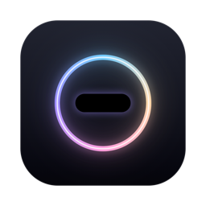
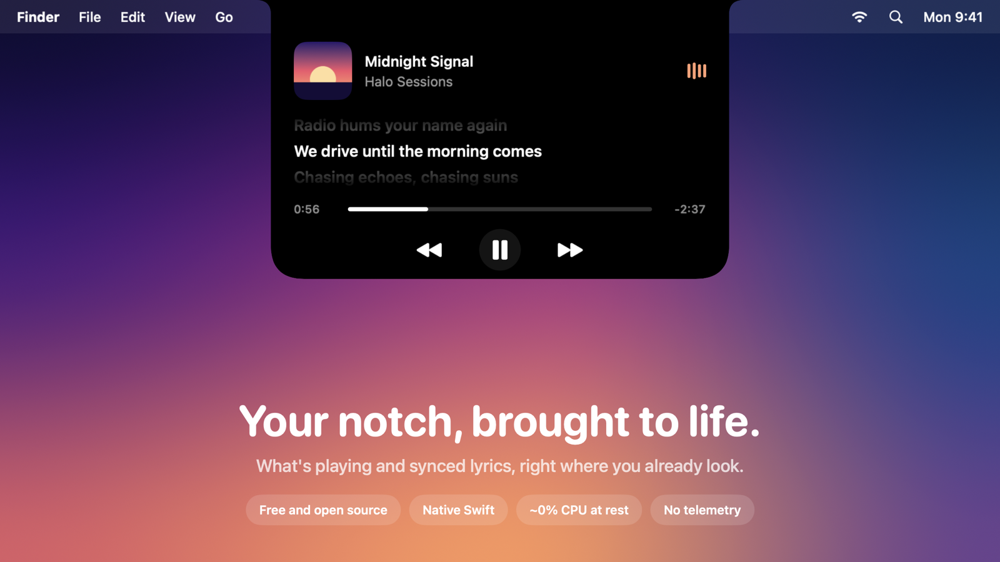
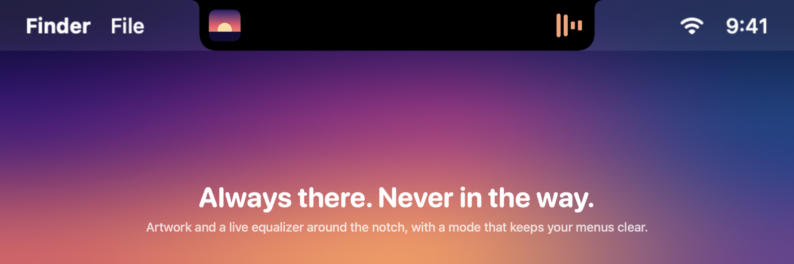
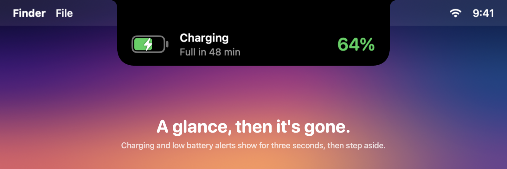
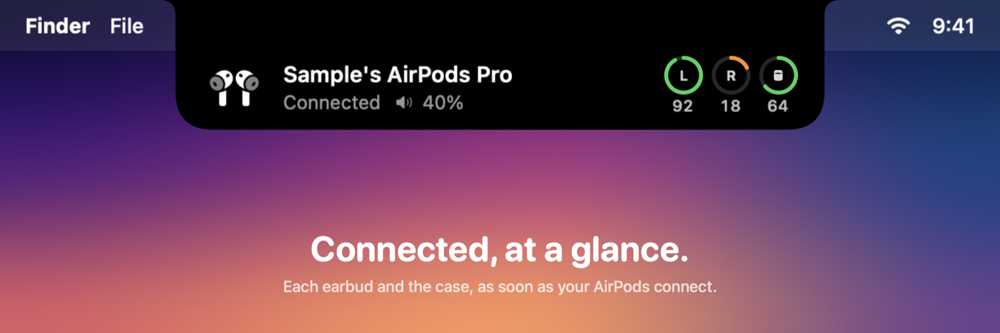
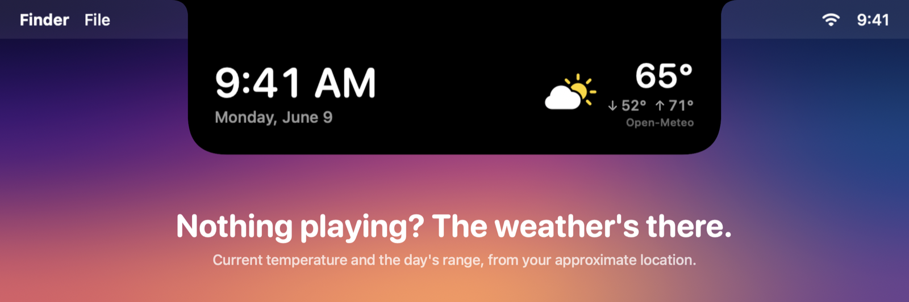
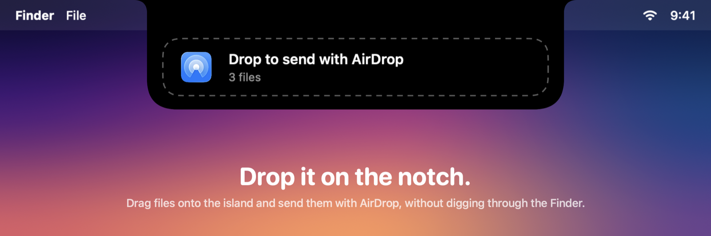
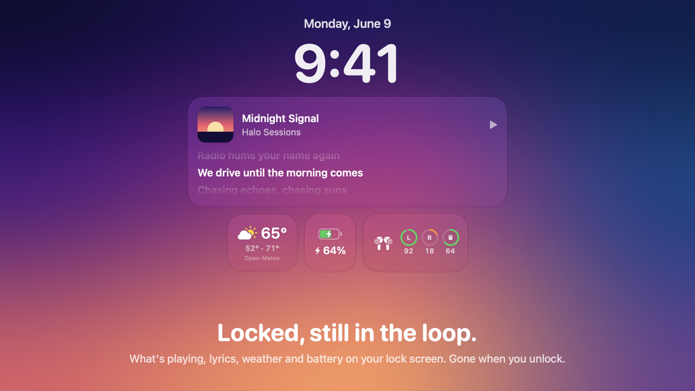

<div align="center">



# Halo

**Your notch, brought to life.**

What's playing, synced lyrics, AirPods, battery, weather, AirDrop and your lock screen,
all around the MacBook notch. Free, open source and native.

[](https://github.com/NxRitsu/Halo/releases/latest)
[](#requirements)
[](LICENSE)
[](https://github.com/NxRitsu/Halo/actions/workflows/ci.yml)

**[⬇︎ Download Halo](https://github.com/NxRitsu/Halo/releases/latest)**

</div>



> 🇫🇷 **En bref :** Halo donne vie à l'encoche du MacBook : lecture en cours avec paroles
> synchronisées, AirPods, batterie, météo, AirDrop en déposant des fichiers sur l'encoche, et des
> widgets sur l'écran verrouillé. Gratuit, open source, natif et léger, sans télémétrie.
> Interface en anglais et en français.

## Why Halo

- **Native and light.** Swift and SwiftUI, no Electron, no web view. Halo reacts to system events
  instead of polling, and sits at about 0% CPU when nothing happens.
- **Private by design.** No account, no analytics, no telemetry. The few requests Halo makes are
  listed [below](#privacy), and each one can be turned off.
- **Made for the notch.** The island hugs the notch to the pixel and blends into it at rest. On
  Macs without a notch and on external displays, Halo draws a matching virtual island.
- **Yours to shape.** Every feature can be turned off on its own, in English or in French.

## Features

### Now playing, with synced lyrics

Hover the notch to open the player: artwork, controls, a scrubbable progress bar and the lyrics,
in time with the music. It works with Apple Music, Spotify, Deezer and players in your browser.
While music plays, the artwork and a live equalizer sit on each side of the notch, and a mode keeps
them out of the way whenever they would cover menu bar items.



### Alerts that step aside

Plug in your charger, run low on battery or connect your AirPods: the island shows it for a few
seconds, then goes back to what it was doing. AirPods show each earbud and the case.

| | |
| --- | --- |
|  |  |

### Weather and AirDrop

When nothing is playing, the island shows the time and the weather where you are. Drag files onto
the notch and it turns into a drop zone that sends them with AirDrop.

| | |
| --- | --- |
|  |  |

### On your lock screen

While your Mac is locked, Halo shows what's playing with its lyrics, the weather, the battery and
your AirPods below the clock. Everything disappears as soon as you unlock.



<sub>Images rendered from Halo's real views, with a made-up track, sample data and a sample menu bar.</sub>

## Requirements

- macOS 26 (Tahoe) or later, including macOS 27 (Golden Gate)
- Apple Silicon Mac (a notch is optional)

## Installation

1. Download the latest `.dmg` from the [Releases](https://github.com/NxRitsu/Halo/releases/latest)
   page and drag Halo to your Applications folder.
2. Open Halo once and dismiss the warning: its builds aren't notarized by Apple for now.
3. Open **System Settings → Privacy & Security**, scroll down and click **Open Anyway** next to the
   message about Halo, then confirm.

Halo has no Dock icon and no window. Right-click the island, or use the menu bar icon, to open its
settings.

### Updates

Halo updates itself. On the second launch it asks whether to check for updates automatically, and
you can change this or check by hand in **Settings → General**. Updates are verified with a
signature before they are installed, and your permissions carry over.

## Privacy

Halo has **no analytics, no telemetry and no account**. Only three kinds of network requests ever
leave your Mac, and all of them can be turned off:

| Request | Data sent | Why |
| --- | --- | --- |
| Lyrics ([LRCLIB](https://lrclib.net)) | Track title, artist, album, duration | To fetch synced lyrics |
| Weather ([Open-Meteo](https://open-meteo.com)) | Approximate location (reduced accuracy, coordinates rounded to about 1 km) | To show the current weather |
| Updates ([GitHub](https://github.com/NxRitsu/Halo/releases)) | Nothing but the request itself, which reveals your IP address to GitHub, like any download | To find and download new versions |

Everything else (media info, battery, Bluetooth, files) stays on your Mac.

- **Permissions.** Halo asks for Bluetooth to detect your audio devices and for your location to
  show the weather. It asks for Accessibility only if you choose to show playback around the notch
  "when there's room", to read where menu bar items are, not what they say.
- **Location.** Your location is never saved or logged. Turning the weather off stops both the
  location and the requests, and deletes the last saved result.
- **AirDrop.** Files you drop on the island go through AirDrop only, to the device you pick. A file
  that only exists inside an app, such as a photo dragged from Photos, is saved temporarily and
  deleted once AirDrop is done.
- **Lock screen.** Anyone near your locked Mac can read its widgets. Turn any of them off in
  **Settings → Lock Screen**.

## Building from source

```sh
brew install xcodegen
git clone https://github.com/NxRitsu/Halo.git
cd Halo
xcodegen generate
open Halo.xcodeproj        # or: xcodebuild -scheme Halo -configuration Debug build
```

The `.xcodeproj` is generated from `project.yml` and is not committed. By default the app is signed
ad hoc. To sign with your own identity, copy `Local.xcconfig.example` to `Local.xcconfig` and set
your team ID. Debug builds don't update themselves. `scripts/render-visuals.sh` renders the images
of this page from the app's views.

## FAQ

**Does Halo work without a notch?**
Yes. Halo shows a virtual island centered at the top of the screen, and you can choose to show it
on every display.

**Why does Halo use private Apple APIs?**
Some features, such as reading what's playing system-wide or drawing on the lock screen, have no
public API. Each of them turns itself off cleanly, with an explanation in Settings, if the API is
unavailable on your version of macOS.

**"When there's room" doesn't work after an update. What do I do?**
Versions older than 0.2.1 lose the Accessibility permission when they update. Turn Halo on in
**System Settings → Privacy & Security → Accessibility**, then use **Reopen Halo** in
**Settings → Island**. If it still doesn't work, remove Halo from the list and add it back. The
**Open System Settings** button in **Settings → Island** goes straight to the right place.

**How much CPU does it use?**
Halo is event-driven: it reacts to system notifications instead of polling. At rest it sits at
about 0% CPU and uses around 20 MB of memory.

**How do I report a bug?**
Open an issue and paste the report from **Settings → Diagnostics → Copy report**. It contains no
personal data.

## Credits

- Lyrics provided by [LRCLIB](https://lrclib.net).
- Weather data by [Open-Meteo](https://open-meteo.com) (CC BY 4.0).
- Updates powered by [Sparkle](https://sparkle-project.org).

See [THIRD_PARTY_NOTICES.md](THIRD_PARTY_NOTICES.md) for details.

## License

[MIT](LICENSE)
